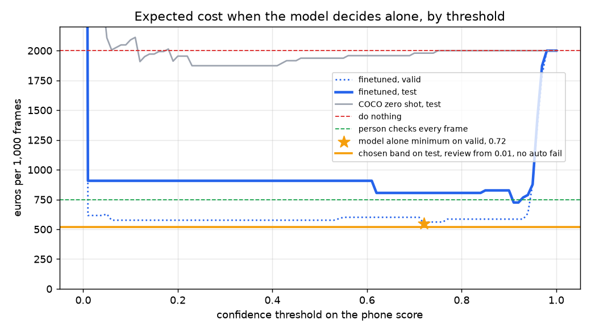

# Assignment 2 Report

- **Name**: Samer
- **Student ID**: 19583
- **Email**: sroz.ieu2022@student.ie.edu
- **Group**: BBADBA 5A

## Business problem, and the cost of being wrong

A delivery company runs 300 vans with a cabin camera pointed at the driver. Using a phone while driving is against company policy and it is one of the main causes of crashes. Today a safety analyst would have to look at footage to know if a driver was on the phone. The model looks at one frame per van every 10 minutes, which is 48 frames per van per 8 hour shift and 14,400 frames a day, and scores how likely it is that the driver is texting or on a call.

Every frame gets one of three outcomes.

1. **Pass.** Nothing happens.
2. **Fail.** An automatic coaching alert goes to the driver and their manager.
3. **Review.** A safety analyst looks at the frame and decides.

The positive class is phone use, meaning texting or talking on the phone. The two mistakes do not cost the same.

- **False negative, a missed phone user.** The driver is not coached and keeps the habit, and the company carries the extra crash risk. This is the expensive mistake. I put it at 40 euros per missed frame.
- **False positive, an automatic alert about a driver who was not on the phone.** The manager and the driver waste time on a coaching talk about nothing, and the driver loses trust in the system. I put it at 15 euros.

So a miss costs about 2.7 times a false alert. That asymmetry is why the model should lean toward flagging, and it is also why a person in the loop is worth paying for, since a review costs much less than either mistake.

## Dataset

I used [yzc/distracted-driver-detection-fxeff](https://universe.roboflow.com/yzc/distracted-driver-detection-fxeff), version 3, from Roboflow Universe, licensed CC BY 4.0. Workspace `yzc`, project `distracted-driver-detection-fxeff`, version `3`. I used it as published, with no fork and no relabelling.

One image is a side view of a driver in a car, 640 by 480. Each image has exactly one box around the driver, labelled with one of 8 behaviours.

| Class | What it is | Positive for my decision |
|---|---|---|
| c0 | Safe driving | no |
| c1 | Texting | yes |
| c2 | Talking on the phone | yes |
| c3 | Operating the radio | no |
| c4 | Drinking | no |
| c5 | Reaching behind | no |
| c6 | Hair and makeup | no |
| c7 | Talking to passenger | no |

The dataset fits the decision, not just the topic. The decision is about what the driver's hands and phone are doing, and that is exactly what the labels describe. The six negative classes are also the right negatives. A fleet camera mostly sees safe driving, but the frames that fool a phone detector are the ones where a hand is near the face or holding something, like drinking, makeup or reaching. Those are all in the data as their own classes.

I first looked at wildfire smoke datasets. The best one had a broken export with a single class named with a dash and most images unlabelled, and the others mixed up their class names, so I dropped the idea.

## What the dataset's composition implies

| Class | Train | Valid | Test |
|---|---|---|---|
| Safe driving | 154 | 50 | 22 |
| Texting | 235 | 60 | 34 |
| Talking on the phone | 225 | 63 | 37 |
| Operating the radio | 156 | 50 | 19 |
| Drinking | 163 | 40 | 23 |
| Reaching behind | 168 | 38 | 22 |
| Hair and makeup | 146 | 52 | 28 |
| Talking to passenger | 144 | 45 | 26 |
| **Images** | **1,391** | **398** | **211** |

There is one box per image, 2,000 boxes in total. The box covers 64% of the image at the median, and never less than 31%.

1. **It is really image classification.** With one huge box per image, the detection part is easy and mAP50-95 mostly measures how tightly the box hugs the driver, which my decision does not care about. What matters is the class score. This is also why I trained at 320 pixels, a small object would have needed more.
2. **Per class test numbers are thin.** The test split has 19 to 37 images per class. With 19 radio images, one mistake moves recall by 5 points. Any per class gap smaller than about 2 or 3 images I treat as noise.
3. **The class mix is not production.** Phone use is 34% of the test images, but in real driving it is around 5%. The cost of a threshold depends heavily on that mix, so I never cost the raw confusion matrix. I take the rates per class from the split and reweight them to a 5% base rate.
4. **The test split is easier than production.** The class names and file names match the State Farm distracted driver dataset from Kaggle, at least for most images. That was staged with a small group of drivers in a few cars, and Roboflow split the images at random, not by driver. So the same people and cars are in train and test. A perceptual hash check found 8 test images that are near copies of train images. Real fleet cameras are mounted in front of the driver, see many more people, and see night and infrared. So the test score is an upper bound, and I cannot conclude how well this works on a new driver.

## Finetuning and baselines

I finetuned `yolo11n` for detection, starting from the COCO checkpoint. The best weights are in `weights/best.pt`, which is what the dashboard loads. I kept detection because the dataset is published as detection and I used it as it is. I chose the nano model because I trained on CPU and the task is easy for the model.

Training ran in a cloud container with 2 CPU cores and no GPU. Settings were 30 epochs, image size 320, batch 16, patience 10, seed 0. It took about 1 hour 42 minutes. Validation mAP50 went from 0.23 after epoch 1 to 0.92 after epoch 10 and 0.99 at epoch 30, still slowly improving.

For the decision, an image's phone score is the highest confidence of any texting or calling box in it. The COCO model has no driver classes, but it does have a cell phone class, so its phone score is the confidence of its best cell phone box. Each model's threshold below is the one that minimises cost on the valid split.

**Phone decision on the 211 test images.**

| Model | Threshold | TP | FP | FN | TN | Precision | Recall |
|---|---|---|---|---|---|---|---|
| Finetuned yolo11n | 0.72 | 71 | 3 | 0 | 137 | 0.959 | 1.000 |
| COCO yolo11n zero shot, cell phone box | 0.13 | 12 | 2 | 59 | 138 | 0.857 | 0.169 |
| Trivial, never flag | none | 0 | 0 | 71 | 140 | none | 0.000 |

**Detection on test.**

| Model | AP50 | mAP50-95 |
|---|---|---|
| Finetuned yolo11n | 0.982 | 0.909 |
| COCO yolo11n zero shot | 0 | 0 |
| Trivial, predict nothing | 0 | 0 |

The COCO model gets 0 on detection by construction, since none of the 8 classes exist in COCO. The more honest comparison is the phone decision. COCO only finds 12 of 71 phone users, because it needs to see the phone itself, and in these side views the phone is often hidden behind the hand or held against the ear. The finetuned model learned the posture, the hand at the ear or both hands low over the lap, so it does not need the phone to be visible.

Some of this gap is real, but some of it comes from the same drivers being in train and test, as explained above. The recall of 1.000 is also partly luck. On the valid split, 4 of 123 phone users score below 0.72 and would be missed.

## Per-class evaluation and failure modes

The first two columns are Ultralytics detection metrics, which also depend on the box. The image level columns take the top box of each image as the prediction, which is what the decision uses.

| Class | Test images | Detection precision | Detection recall | AP50 | Image level precision | Image level recall |
|---|---|---|---|---|---|---|
| Safe driving | 22 | 0.915 | 1.000 | 0.989 | 0.875 | 0.955 |
| Texting | 34 | 0.942 | 1.000 | 0.993 | 0.944 | 1.000 |
| Talking on the phone | 37 | 0.948 | 1.000 | 0.979 | 0.949 | 1.000 |
| Operating the radio | 19 | 0.989 | 1.000 | 0.995 | 1.000 | 1.000 |
| Drinking | 23 | 0.954 | 0.901 | 0.950 | 0.955 | 0.913 |
| Reaching behind | 22 | 0.998 | 1.000 | 0.995 | 1.000 | 1.000 |
| Hair and makeup | 28 | 0.909 | 0.893 | 0.967 | 0.926 | 0.893 |
| Talking to passenger | 26 | 0.988 | 0.885 | 0.987 | 1.000 | 0.846 |

**Confusion matrix on test, image level.** Rows are the true class, columns the predicted class.

| True, predicted | Safe | Texting | Phone call | Radio | Drinking | Reaching | Hair and makeup | Passenger |
|---|---|---|---|---|---|---|---|---|
| Safe driving | 21 | 1 | 0 | 0 | 0 | 0 | 0 | 0 |
| Texting | 0 | 34 | 0 | 0 | 0 | 0 | 0 | 0 |
| Talking on the phone | 0 | 0 | 37 | 0 | 0 | 0 | 0 | 0 |
| Operating the radio | 0 | 0 | 0 | 19 | 0 | 0 | 0 | 0 |
| Drinking | 0 | 0 | 0 | 0 | 21 | 0 | 2 | 0 |
| Reaching behind | 0 | 0 | 0 | 0 | 0 | 22 | 0 | 0 |
| Hair and makeup | 0 | 0 | 2 | 0 | 1 | 0 | 25 | 0 |
| Talking to passenger | 3 | 1 | 0 | 0 | 0 | 0 | 0 | 22 |

At image level the model gets 201 of 211 test images right, which is 95.3%. Always guessing the biggest class in train, texting, would get 16.1%.

The headline number is carried by the two classes I care about. Texting and calling both have recall 1.000 at image level. The classes that drag are the ones where a hand is near the face or the driver is turned.

- **Talking to passenger, recall 0.846.** 4 of 26 were wrong. 3 were called safe driving and 1 was called texting. The driver is turned toward the passenger and the hands are on the wheel, which looks like safe driving from the side.
- **Hair and makeup, recall 0.893.** 3 of 28 were wrong. 2 were called talking on the phone and 1 drinking. A hand held up to the face or mouth looks like a phone at the ear. This is the failure that matters most for the business, because it creates false alerts.
- **Drinking, recall 0.913.** 2 of 23 were called hair and makeup, again a hand at the face.
- **Safe driving, recall 0.955.** 1 of 22 was called texting. That frame has a passenger holding a phone.

I looked at the 4 test negatives with a phone score above 0.3. Two are makeup frames with a hand at the face, read as a call. One is a driver talking to a passenger with a hand gesture, read as texting. One is labelled safe driving, but a passenger in the frame is holding a phone, so the model is partly right that there is a phone. Two of the four also have heavy speckle noise. So the model's weak spot is a hand near the face, and it cannot tell whose hand holds a phone.

## Cost matrix and operating point

All costs are euros per frame.

| Outcome | Cost | Where the figure comes from |
|---|---|---|
| True positive, phone user coached | 10 | 10 minutes of a manager and 10 minutes of the driver at about 30 euros an hour |
| False positive, automatic alert about an innocent driver | 15 | The same 10 euros of wasted time, plus 5 euros for the dispute and lost trust in the system |
| False negative, phone user missed | 40 | The driver is not coached and keeps the habit. I set it at 4 times the coaching cost |
| True negative | 0 | Nothing happens |
| Review by an analyst | 0.25 | 30 seconds of an analyst at 30 euros an hour |

**Base rate, 5%.** NHTSA's 2023 roadside survey, [Driver Electronic Device Use in 2023](https://crashstats.nhtsa.dot.gov/Api/Public/ViewPublication/813660), found 2.1% of drivers talking on a handheld phone and 3.0% visibly manipulating a device at a typical daylight moment, which adds up to about 5%. A fleet with a phone policy and a camera is probably lower, so I checked lower base rates below.

I assume an analyst who reviews a frame decides correctly. So a reviewed phone user costs 10.25 and a reviewed innocent driver costs 0.25. The expected cost per 1,000 frames is

`1000 * (0.05 * cost_over_phone_frames + 0.95 * cost_over_other_frames)`

where each part uses the share of that class that lands in pass, review or fail.

**Costs are per frame, and that overstates coaching.** At 5%, about 720 frames a day show phone use, more than 2 per driver. In practice the flags for one driver in one shift would be merged into one coaching talk. That makes the 10 euros per caught frame too high, but it is the same 500 euros per 1,000 frames for every policy that catches all phone users, so it does not change which policy wins. It also makes the 40 euros per missed frame too high, since a driver missed in one frame is often caught in the next. The sensitivity below shows the choice holds for any miss cost from 12 euros up.

**The sweep.** I swept both thresholds from 0 to 1 in steps of 0.01, plus a value of 1.01 that means never. Every pair is costed on the valid split, and the cheapest pair is chosen there and then reported on test. The plot shows the single threshold curve, where the model decides alone. Its minimum on valid is at 0.72. On test the same curve bottoms out near 0.92 instead, which is the first sign that the top of the score range is thin.

**The problem I found with the first version.** On raw valid rates, the cheapest band was pass below 0.01 and fail from 0.72. That pick hung on a single image. One safe driver in valid scored 0.71, and no valid negative scored higher, so 0.72 looked perfectly safe. On test, 3 negatives scored between 0.90 and 0.96 and became false alerts, and the cost jumped from 514 euros on valid to 807 on test.

The real issue is sample size. With 275 valid negatives, a false alert rate below about 0.4% is invisible. The costs say that matters, because sending a phone user to review instead of failing him costs only 0.25 euros, while a false alert costs 15. So if more than about 0.09% of innocent drivers score above the fail threshold, reviewing every flag is cheaper than auto failing. Valid cannot tell me whether that rate is above or below 0.09%.

I only noticed this after seeing the test cost, so I have to be honest that the 519 below is no longer a clean holdout number. The fix has to stand on sample size alone, without the test result.

When I pick thresholds, I now count an empty tail as half an image instead of zero, using `(count + 0.5) / (n + 1)` for the share of images above each threshold. This is a standard Jeffreys prior. With 275 negatives, an empty tail becomes 0.5 / 276, which is 0.18%. That is already above the 0.09% break even, so with this valid split any automatic fail threshold loses. For auto fail to win, the valid split would need about 570 or more negatives with none above the threshold. So the rule is not my taste. It says that 275 negatives cannot prove the false alert rate is low enough. Test results stay reported exactly as observed.

**Operating point.** Pass below 0.01, review from 0.01 up, and no automatic fail. The model screens out most frames and a person confirms every flag before anyone is coached. On valid, a lower threshold anywhere from 0.01 to 0.04 costs the same, and the sweep takes the lowest, which reviews a little more but misses less. One valid phone user scores 0.002 and passes even at 0.01.

| Policy | Euros per 1,000 frames on test | Missed phone users | False alerts |
|---|---|---|---|
| Band picked on raw valid rates, 0.01 to 0.72 | 807 | 0 | 2.0% of frames |
| Chosen band, 0.01 and never fail | 519 | 0 | 0 |

**What would change the answer.** I reran the sweep with one assumption changed at a time.

- **Cost of a miss.** Any value from 12 to 160 euros gives a band with no automatic fail. At 10 euros or less, which is no more than the coaching cost, doing nothing wins, because catching a phone user is then not worth the talk. So the exact 40 euros does not matter, only that a miss costs clearly more than coaching.
- **Cost of a false alert.** Below about 8 euros, auto failing from 0.72 becomes cheaper than reviewing every flag.
- **Base rate.** From 1% to 9% the band stays the same. At 10% auto failing from 0.72 wins, because there are more phone users and each one sent to review costs an extra 0.25 euros. This happens with or without the staffing cap.
- **Cost of a review.** Above about 0.50 euros per review, which is about one minute per frame, auto failing wins.

The assumption that would most change my answer is the false alert cost together with the review time. If drivers did not mind wrong alerts, or reviews were slow, the model should decide alone.

## What a person still has to check

With pass below 0.01 and no automatic fail, 7.7% of frames go to a person on test once reweighted to a 5% base rate. That is all the phone users plus 2.9% of everyone else.

- 7.7% of 14,400 frames a day is about 1,110 frames a day.
- At 30 seconds each, that is 9.3 hours of review.
- With 7 productive hours per analyst, that is 1.3 analysts.

That is realistic for a 300 van fleet. One full time analyst plus some help at peak times, or two analysts who also handle other safety work. I capped the sweep at 2 analysts, which is 11.7% of frames, and the chosen band is well inside that. A frame is a still image, so 30 seconds to look at it and click yes or no is a fair estimate. Watching a video clip would take longer.

| Policy | Euros per 1,000 frames | Share reviewed | Analysts needed |
|---|---|---|---|
| Do nothing, every frame passes | 2,000 | 0% | 0 |
| A person checks every frame | 750 | 100% | 17.1 |
| COCO zero shot decides alone | 1,950 | 0% | 0 |
| Finetuned model decides alone, threshold 0.72 | 805 | 0% | 0 |
| **Finetuned model plus review band** | **519** | **7.7%** | **1.3** |

500 euros of every policy that catches all phone users is the coaching itself, which has to happen anyway. Above that floor, the band costs 19 euros per 1,000 frames, against 250 for checking everything by hand and 305 for the model alone. The model alone loses because of false alerts on frames like a hand at the face. Checking everything by hand is cheaper than the model alone in euros, but it needs 17 people staring at mostly safe drivers, and people doing that miss things, which my assumption that analysts are always right does not price. The band is the cheapest option, and it needs a realistic number of people.

## Limitations & next steps

- **Same drivers in train and test.** The 1.000 recall and the 0.98 AP50 are likely too high for new drivers. The fix is to split by driver. The original State Farm data has a driver list that would allow that. Then I would retrain and check that phone recall holds on drivers the model has never seen.
- **Camera angle and lighting.** All images are side views in daylight. A fleet camera sits in front of the driver and records at night in infrared. Before using this, I would collect a few hundred frames from the actual cameras and fine tune again on those.
- **The review band leans on thin tails.** The choice between review every flag and auto fail at 0.72 rests on a handful of high scoring negatives. More valid negatives, a few thousand frames of normal driving, would show the real false alert rate above 0.72. If it is well below 0.09%, auto failing becomes cheaper and the analyst load drops.
- **Analysts are assumed perfect.** Real reviewers make mistakes, especially when most frames are fine. I would measure it by having two analysts review the same 500 frames and counting how often they disagree, then add that error to the cost.
- **Whose phone it is.** One false alert was a passenger holding a phone. A box around the phone, plus a check that it overlaps the driver's hand, would fix this. That needs phone boxes, which this dataset does not have.
- **One frame is a weak signal.** A driver glancing down once is not a habit. Scoring 3 frames in a row and only flagging when 2 agree would cut false alerts, at the cost of slightly later detection.

## Generative AI use disclosure

I used Claude, made by Anthropic, for this assignment. It searched Roboflow Universe with me and checked candidate datasets. It wrote the code for downloading the data, training, scoring, the cost sweep and the Gradio dashboard. It also drafted this report from the results, and I went through and edited it. The framing, the costs and the threshold choice are explained here so that I can defend each of them.
